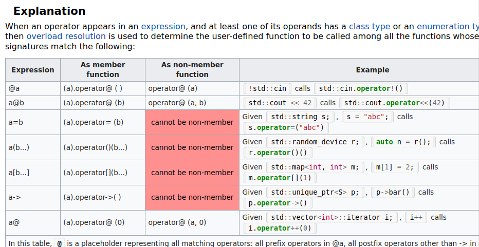

_This project has been created as part of the 42 curriculum by syee for CPP02, it contains notes referenced thorughout the Making of this project_

# C++ Notes
## CPP02 related
From here on out, all classes must be designed in Orthodox Canonical Form which includes the following 4 funcitons:
- Default constructor

Copy constructorvs copt assignment operator are often mistaken for each ther but thislink breaks it down : https://www.geeksforgeeks.org/cpp/copy-constructor-vs-assignment-operator-in-c/


	`class()`
- Copy constructor - does a deep copy (used when a new object is created with an exsiting object)
	- https://www.geeksforgeeks.org/cpp/copy-constructor-in-cpp/
	
	
	`class (const cass& other)` 

- Copy assignment operator - frees old memory and copies new (also used when existing is assigned to exsiting object)
	- stackoverflow.com/questions/59364218/copy-assignment-operator-clarification
	`class& operator=(const class& other)`
	
- Destructor
	
	`~class`
## Orthodox canonical form 
KNowledge regarding this is extracted from : https://hackmd.io/@ChloeIsCoding/S1D-y80bll (it covers in dept about the copy constructor and operator copy)
- default implementation provided by the compiler provides shallow copy

### shallow copy 
from what i understand its whne you assign the values it references the previous data
- https://www.geeksforgeeks.org/blogs/difference-between-shallow-and-deep-copy-of-a-class/
I think it's more obvious in oop because variables come from a class which may be dynamicaly allocated, when we assign the values it might not occur to us. Whereas dueing c++ if we did something like assign a pointer to another variable its more obvious to us that by accessing the same variable with a free'd object, we'd be accessing somethng invalid

## constexpr
- constexpr is a C++ keyword (short for constant expression) that tells the compiler a variable, function, or constructor can be evaluated at compile time rather than runtime

## Two's complement
- to get a signed value, flip the value's binary bits and add 1 
https://www.youtube.com/watch?v=ZMsrZvBmQnU <- demonstrates it

## ex00 related
- The subject requires me to read up on integers and floating point numbers, in which it suggests integers and floating point numbers have different characteristics. I will be touching upon fixed-point numbers. 

### Fixed point numbers
- C++ has no fixed point numbers (i dont remember what is fixed opoint numbers)

### scalar types 
- performance accuary , range  precision..?

### const behind functions
```
	int getRawBits(void) const; 
```
- https://stackoverflow.com/questions/9790927/what-does-const-behind-a-function-header-mean
- Trailing const means the member function does not modify the object it’s called on, and it can be called on const objects.
- It’s not about the returned value. It’s about *this.
- Getters should be const because reading a value shouldn’t change the object.

### "Why can't i assign a default value for static const int using member initilization?"
- In C++, you usually cannot initialize a static const int inside the class body because static variables require a single, distinct memory location across your entire program. The class header only serves as a blueprint, not a physical location in memory.

### "what is static inside the class"
- static means "Shared Class-Wide"
- Inside the header file (.h), static tells the compiler: "This variable belongs to the class itself, not to individual objects." Every instance of the class shares this exact same variable. (obj a and obj b form class MyClass shares the same variable address)

## ex01 related 
- https://hackmd.io/@ChloeIsCoding/Bk8gPG1Mxx

### floating point vs double
- https://www.geeksforgeeks.org/cpp/difference-float-double-c-cpp/
the more crucial thing to note :
- double is more precise (up to 15 digit precistion), but takes up more space (8 bytes) , denoted as %lf
- float is less precise (up to 15 digit precistion), and takes up lesser space (4 bytes), denoted as %f

Minor conclusion double is a better float

### fixed point vs floating point
- https://stackoverflow.com/questions/7524838/fixed-point-vs-floating-point-number

### printing out floating point with more decimal points with cout
- By default, cout displays up to 6 significant digits total and automatically drops trailing zeros. Combining fixed and setprecision forces it to count digits after the decimal point and pads empty places with zeros
- using set pricision : https://www.tutorialspoint.com/article/printing-the-correct-number-of-decimal-points-with-cout-in-cplusplus
``` c++
int main() {
    // Creating a double type variable
    double a = 3.912348239293;

    // Creating a float type variable
    float b = 3.912348239293f;

    // Setting the precision to 12 decimal places
    cout << setprecision(13);

    // Printing the two variables
    cout << "Double Type Number  = " << a << endl;
    cout << "Float Type Number   = " << b << endl;

    return 0;
}
```


### float and double 
- We must add the suffix f or F at the end of a float value. This is because the compiler interprets decimal values without the suffix as double.
- https://www.programiz.com/cpp-programming/float-double

### what are fracitonal bits
- https://stackoverflow.com/questions/36660171/understanding-fixed-point-fractional-part

### bitshifting 
- can only be done with int values
```c++
int main(void)
{
	int x = 128; //(int has 4 bytes)

	int y = x >> 8; //shifts to the right by 8 bits (operator must be on the  right or else its appending/ inserting)
	std::cout << y << "\n";
	 y = x << 8; //shifts to the left by 8 bits
	std::cout << y << "\n";
}
```

### converting using typecast 
- https://www.geeksforgeeks.org/dsa/convert-int-to-float/

### THE SHIT : Fixed point
- https://www.geeksforgeeks.org/computer-organization-architecture/fixed-point-representation/
- https://medium.com/@oumaimafisaoui/floating-and-fixed-point-representation-in-c-what-is-going-on-b71af54718a5 (MAIN article that helped to demistify this entire thng, BUT ITS WRONG)
		To convert an integer number `Num` to a fixed-point number, multiply it by \(2^n\), or left-shift its bits by `n`, where `n` represents the number of fractional bits. (Think if want to move then `* 2^n` but if want to move back then `/ 2^n` cus, if `2^8 / 2^8 is 8 - 8`, secondary school maths )

		With the fractional bits equal to 8, we get:

		```text
		Num.00000000
		```

		The scaling factor is:

		\[
		2^8 = 256
		\]

		To convert a fixed-point value back to an integer, divide it by the same scaling factor:

		```cpp
		(int)fixed_point_number / (1 << 8);
		```

		Or:

		```cpp
		fixed_point_number / 256;
		```


- https://www.youtube.com/watch?v=bbkcEiUjehk (another main thing)

### intigers, fixed floating point, floats
- ints have 4 bytes, 8 bits depending on (1' complement , 2's complement and ..) the bits are represeted differently
- floats have 4 bytes, the first is signed bit , 8 for exponents, 23 for mantisa bits (fractional bits)
	- source : https://blog.demofox.org/2017/11/21/floating-point-precision/
- fixed floating point, in this exercise, 8 for mantissa bits fractional bits, remaining 24 bits for exponent


### Overloading <<
- im not quite sure how to do it therefore i asked ai for this part 
- initially my plan was :
	```c++
		void MyClass::operator<<()
		{
			//code
		}
	```
	but it caused a compilation error
- therefore i tried :
	``` c++
		std::ostream& operator<<(std::ostream& os , const Fixed& other)
	```
	- source1 :https://learn.microsoft.com/en-us/cpp/standard-library/overloading-the-output-operator-for-your-own-classes?view=msvc-170& 
	- source 2 (chatgpt) :
		```
			Stream Insertion Operator (<<)

			The << operator is used to insert data into an output stream, such as std::cout and std::ofstream.

			1. Function Structure

			std::ostream& operator<<(std::ostream& os, const Fixed& other);

			The operator has two operands:

			std::ostream& os: Left operand (output stream).

			const Fixed& other: Right operand (object being printed).

			Conceptually:

			std::cout << fixedObj;

			// Equivalent to:
			operator<<(std::cout, fixedObj);

			2. Why Non-Member and Friend?

			The left operand belongs to std::ostream, not our custom class.

			Therefore, we implement operator<< as a non-member function.

			friend allows the function to access private and protected members without making it a class member.

			class Fixed
			{
				public:
					friend std::ostream& operator<<(std::ostream& os, const Fixed& other);
			};

			3. Why Return std::ostream&?

			std::ostream& operator<<(std::ostream& os, const Fixed& other)
			{
				os << other.getRawBits();
				return os;
			}

			Two reasons:

			Operator chaining: Returning the stream allows multiple << operations, e.g. std::cout << fixedObj << std::endl.

			Avoid copying: Streams are non-copyable, so returning a reference preserves the original stream.

			4. Why std::ostream Instead of std::cout?

			std::ostream is the general output stream interface. Both std::cout and std::ofstream can be passed as std::ostream&.

			This allows the same overloaded operator to work with different output destinations.
		```

### friend in classes
- trying to implement << overloading lead me to learn what friend does in c++
- Friend functions and friend classes in C++ allow specific functions or classes to access the private and protected members of another class. 
- https://www.w3schools.com/cpp/cpp_friend_function.asp

### ex01 research TLDR...
- tldr what i found out about myself from doing this exercise was :
	- i dig too deep without trying the bsic stuff first (kept trying to understand how float & fixed-float can be stored into an int value without error) 
		- i think how store
		- look at fixed and fractional bits
		- still dont understand how its stored
		- finds out formula to change fixed to int and int to fix
		- does not verify if that works
		- tries to forcefully use my logic of mantissa bits = fracitonal bits and use this logic to shift the bits
		- asks ai about the error
		- tells me to reflect and test
		- found out my concept is wrong
		- program works but still dont understand why 8 bits 

## ex02 related:
- overloading overload, it requires us to overload a total of (oh my days)

### Friend function
- https://www.geeksforgeeks.org/cpp/friend-class-function-cpp/

### what is a static member function
- A static member function is a function that belongs to the class rather than any specified object it can be called without creating/using an object.

- it is shared among all objects of the class
Example :
```c++
	Class MyClass
	{
		public :
			static int addition(int a, int b)
			{
				return (a+b);
			}
	};
	
	int main()
	{
		int y = MyClass::addition(10, 12)
	}
```

- The access specifier is not limited to public, if it is a private static function it can be called from another member function. I suppose itsmainly used as an utility fnction within thecalss 
```c++
	class MyClass
	{
	private:
	    static void helper()
	    {
		std::cout << "Hello\n";
	    }

	public:
	    static void execute()
	    {
		helper(); // Allowed!
	    }
	};
```

### overloading operators
- https://www.codecademy.com/learn/learn-advanced-c-plus-plus/modules/operator-overloading-in-c-plus-plus/cheatsheet (main help)
- https://www.geeksforgeeks.org/cpp/operator-overloading-cpp/ (basic help)

Main reference : 
- https://en.cppreference.com/cpp/language/operators (resource ot back my interpretation)



### Found errors 
- Doing `Fixed operator+(Fixed& that);` yeilded the error:
```bash
	main.cpp:19:41: error: cannot bind non-const lvalue reference of type ‘Fixed&’ to an rvalue of type ‘Fixed’
   19 |         Fixed const b( Fixed( 5.05f ) * Fixed( 2 ) );
      |                                         ^~~~~~~~~~
	In file included from main.cpp:13:
	Fixed.hpp:53:40: note: initializing argument 1 of ‘Fixed Fixed::operator*(Fixed&)’
	53 |                 Fixed operator*(Fixed& that);
		|                                 ~~~~~~~^~~~
	make: *** [<builtin>: main.o] Error 1
```
- But `Fixed operator+(const Fixed& that) const;` helped fix it
- Because Fixed( 2 ) is a temporary (an rvalue), and a non-const lvalue reference (Fixed&) can’t bind to a temporary, whereas const Fixed& can. Adding const also promises that that won’t be modified, which is what allows the compiler to accept the temporary without copying it.
- const after it protects a, const inside protects b

### lvalues and rvalues 
- https://en.cppreference.com/cpp/language/value_category


### static functions
- 